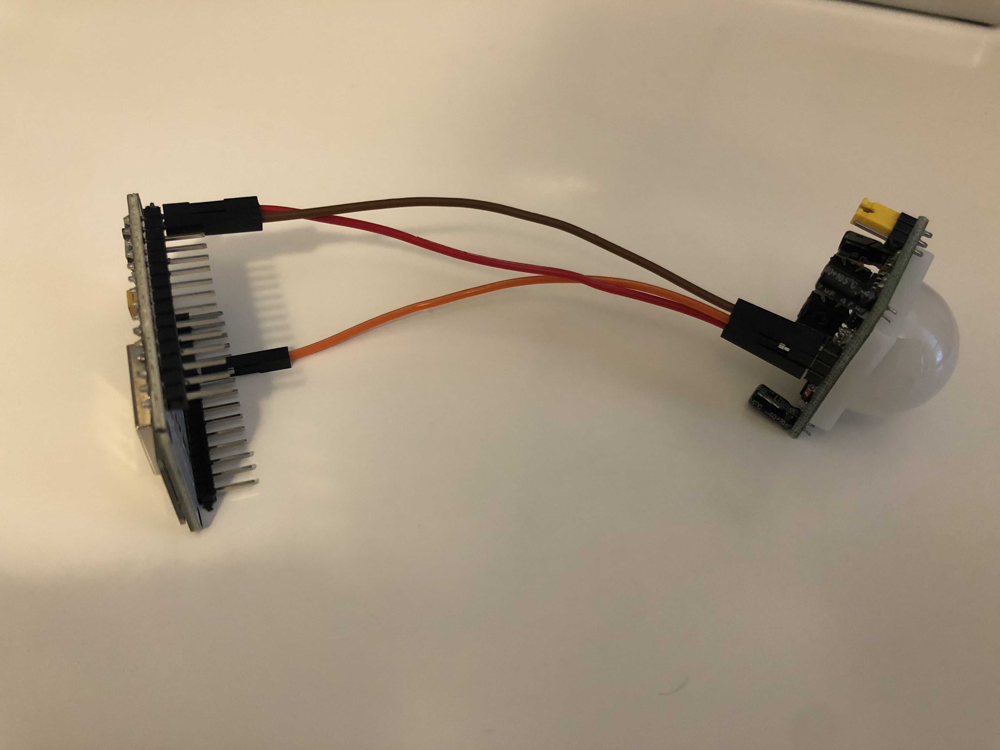

# Hardware

## Prototype Status

We are currently building out our first hardware prototype for FLOM. Each of prototypes, if successful, will be installed in each of the study rooms in the Folsom Library to detect when they are occupied. The prototype will interface wirelessly with the WebApp.

## Hardware Specifications

**Microcontroller**: 
- HiLetgo 1PC ESP8266 NodeMCU CP2102 ESP-12E Development Board (using Arduino instead of NodeMCU firmware)
- Amazon link: https://www.amazon.com/HiLetgo-Internet-Development-Wireless-Micropython/dp/B010O1G1ES/
- Purpose: The microcontroller is the brain of the prototype. With it's built in WiFi chip, it will wirelessly connect to the WebApp to provide real-time occupancy data for the study room it's located in.

**Sensor**:
- Geekstory HC-SR501 Pir Pyroelectric Infrared PIR Sensor Body Motion Sensor Modules for Arduino
- Amazon Link: https://www.amazon.com/Geekstory-HC-SR501-Pyroelectric-Infrared-Modules/dp/B07X31RVJY/
- Purpose: To sense whether or not there is motion in the room and relay that data to the microcontroller.

**Connecters**:
- Antrader Breadboard Jumper Wires 40 Pin 10CM Female to Female
- Amazon Link: https://www.amazon.com/Antrader-Breadboard-Dupont-Arduino-Raspberry/dp/B07S2RH6Q4/
- Purpose: To connect controller to motion sensor.

## Next Development Steps

1. We are going to make any necessary changes to the current hardware codebase to make it compatible with the current prototype.
2. Get a stable version of the software running with minimal bugs.
3. Develop installation plan for the library, including location in each study room, how to power each sensor once in the study room, etc.

## Pictures

Here are some pictures of the current prototype:

Entire prototype

Microcontroller (power pins)
")

Microcontroller (data pin)
")

Microcontroller (micro-USB)
")

Motion sensor (with cap)
")

Motion sensor (without cap)
")

