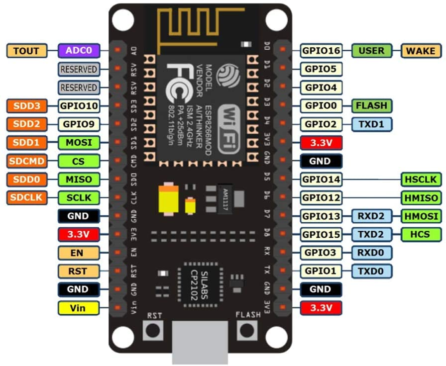
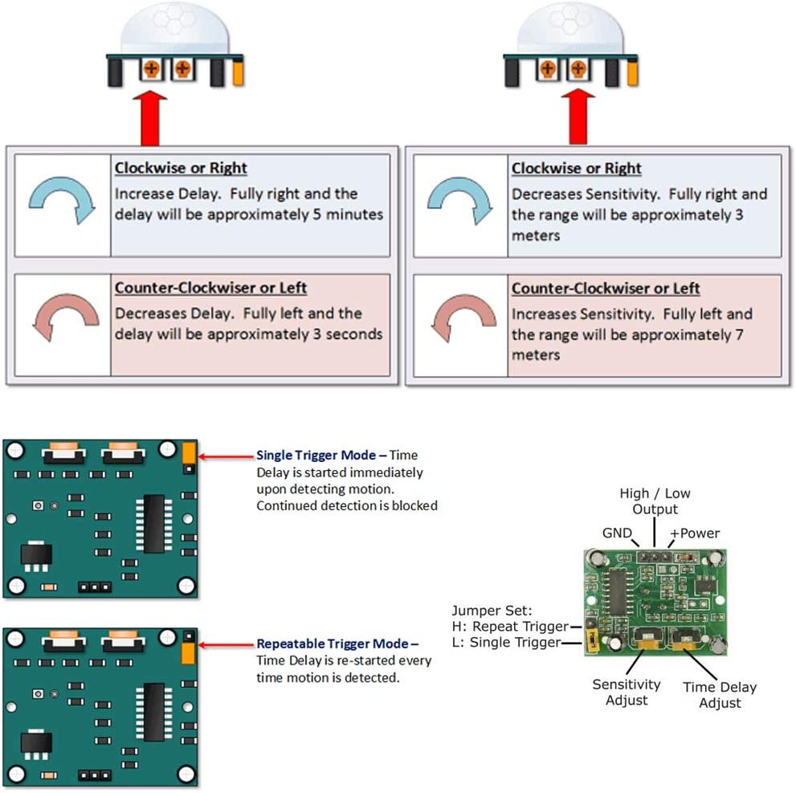
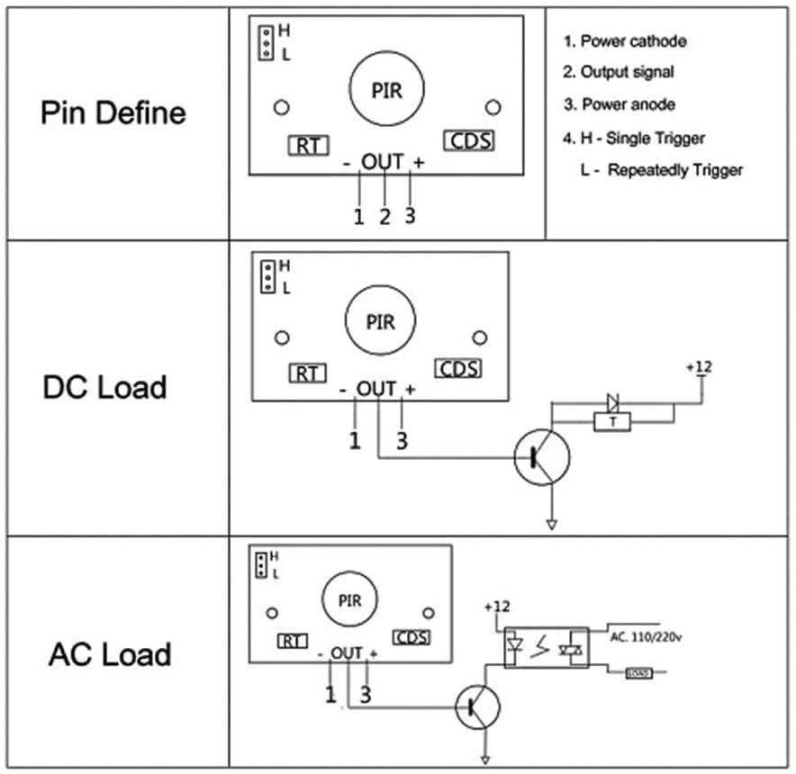

# Motion Sensor Setup

## What You'll Need

- Microcontroller board
- Female-to-female pin wires
- Motion sensor

The actual part specifications are located in the README file of this directory.

## Connecting The Parts

1. Retrieve 3 wires from your package of wires.
2. Locate the 3 pins on the under-side of the motion sensor. Each one has a different purpose. The label for each pin is located under the infrared-sensor plastic covering (which can simply be pulled off).
3. Locate the set of pins on the under-side of the microcontroller. Again, each one has a different purpose. Labels for each pin are on the top-side of the board (opposite the pins).
4. Connect a wire to the VCC (power) pin on the sensor to a corresponding 5V pin on the microcontroller. This will provide power to the motion sensor.
5. Connect a wire to the GND pin on the sensor to a corresponding GND pin on the microcontroller. This is the ground for the circuit.
6. Connect a wire to the OUT pin on the sensor to a corresponding data input pin on the microcontroller. This is how the senesor will send its data to the microcontroller.

## Some Helpful Diagrams

These diagram pictures were pulled from the Amazon pages for each respective part.

